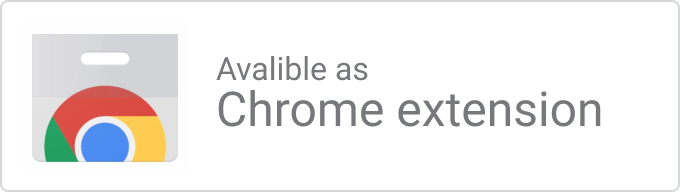

<h1 align="center">
   
   
  Freeze - New Tab Page Extension
   
</h1>

<h4 align="center">A Curated Cinemagraph Each Time You Open a New Tab</h4>

  

 

  
  
   
  
  

<i>Cinemagraphs are still photographs in which a minor and repeated movement occurs,   forming a perfectly  looping video.</i>
 

## Features

🎆 300+ Curated Cinemagraphs

🕑 12h clock, 24h clock, analog clock or no clock

🕶️ Image filters to unify cinemagraphs style

⏲ New Cinemagraph `every time`, `5min`, `15min`, `30min`, `hourly` or `daily`

## How to install

Build the current Manifest V3 source using the development instructions below. The [historical Chrome Web Store release](https://chrome.google.com/webstore/detail/kacdbklgelcjnoejpbafhdelhlnkgpnd) may not include these changes.

 
## Contribute

Found a nice looking Cinemagraph? Add it to [cinemagraphs.json](https://github.com/Hemmingsson/Freeze/blob/master/cinemagraphs.json) and create a pull request.

## Reporting bugs

If you find any bugs or want to provide feedback, you can file bugs in the project's [GitHub Issues page](https://github.com/Hemmingsson/Freeze/issues).

## Dev Environement
### Installation
1. Clone the repository `git clone https://github.com/Hemmingsson/Freeze`
2. Use Node.js 22 or later and run `npm ci`
3. Run `npm run build`

##### Load the extension in Chrome
1. Open Chrome browser and navigate to chrome://extensions
2. Select "Developer Mode" and then click "Load unpacked extension..."
3. From the file browser, choose to `Freeze/build/chrome`

### Developing
The following task can be used when you want to start developing the extension

- `npm run chrome-watch`

## Credits

### Freeze was made with :

- [Extension Boilerplate](https://github.com/EmailThis/extension-boilerplate)
- [instagram.css](https://github.com/picturepan2/instagram.css)
- Cinemagraphs sourced from [imgur.com](https://imgur.com) and [r/Cinemagraphs](https://www.reddit.com/r/Cinemagraphs/)

## License

Freeze is released under the [MIT License](https://github.com/Hemmingsson/Freeze/blob/master/LICENSE).

---

## Build checks

`npm run build` creates Chrome Manifest V3 and Firefox Manifest V2 builds. Run `npm test` after building to check bundled assets. `npm run dist` creates ZIP files in `dist/`.

Decorative video is muted and cannot receive keyboard focus. Firefox owns address-bar focus; the [reported browser bug](https://bugzilla.mozilla.org/show_bug.cgi?id=1652293) may need a Firefox update. Address-bar behavior has not been verified in Firefox.

The cinemagraph list refreshes from GitHub. If the refresh fails, Freeze uses cached or bundled IDs. Video failures stop retrying after three attempts.
